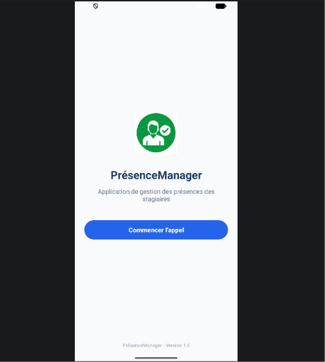

# PrésenceManager

**PrésenceManager** est une application Android destinée à faciliter la gestion des présences des stagiaires.

## Technologies utilisées

- Kotlin
- XML
- Android Studio

## Interface d'accueil

L'application contient une page d'accueil avec :

- Le logo de l'application.
- Le titre PrésenceManager.
- Une description.
- Un bouton « Commencer l'appel ».

## Capture d'écran

## Version

TP01 - Création de l'interface d'accueil